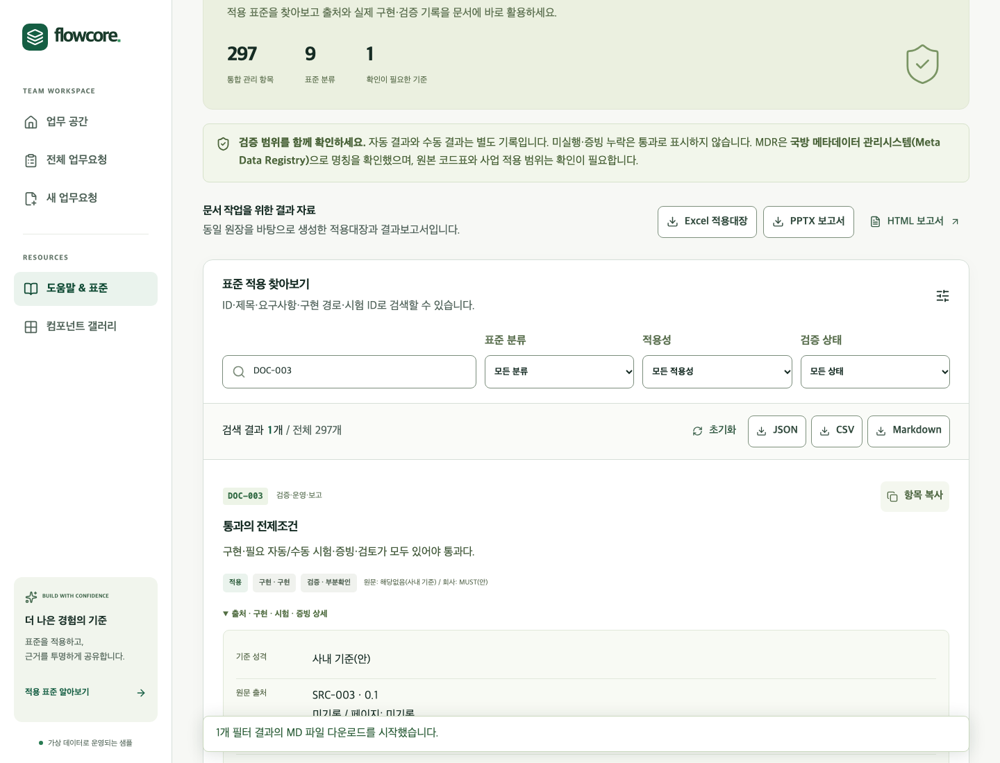
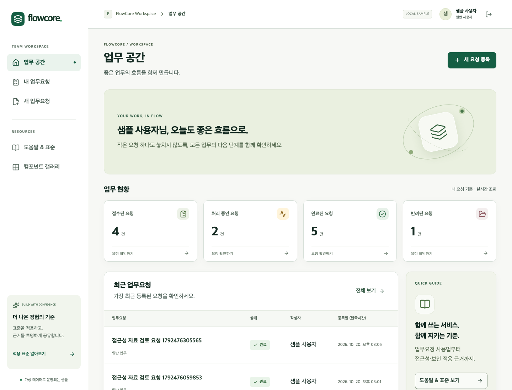
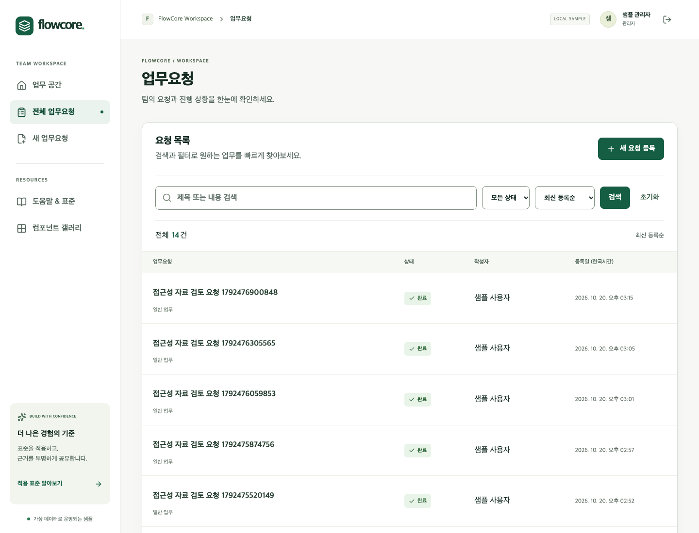
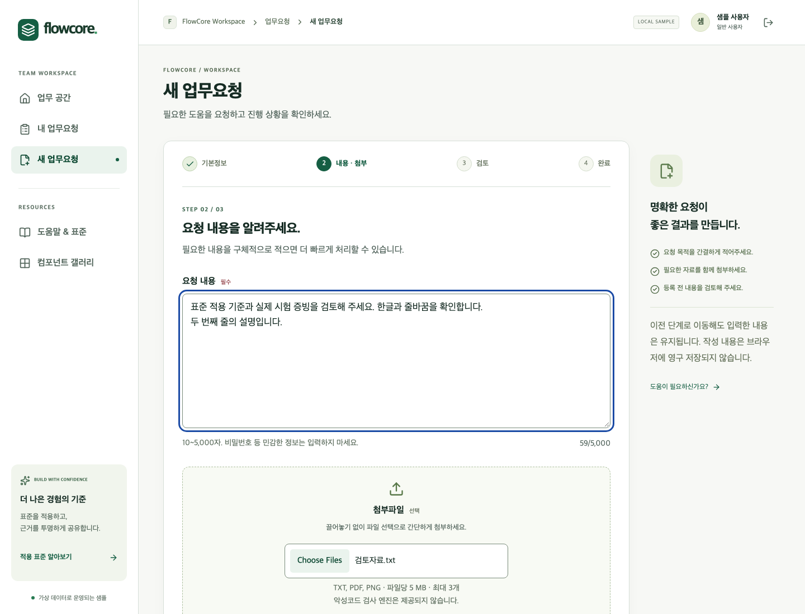
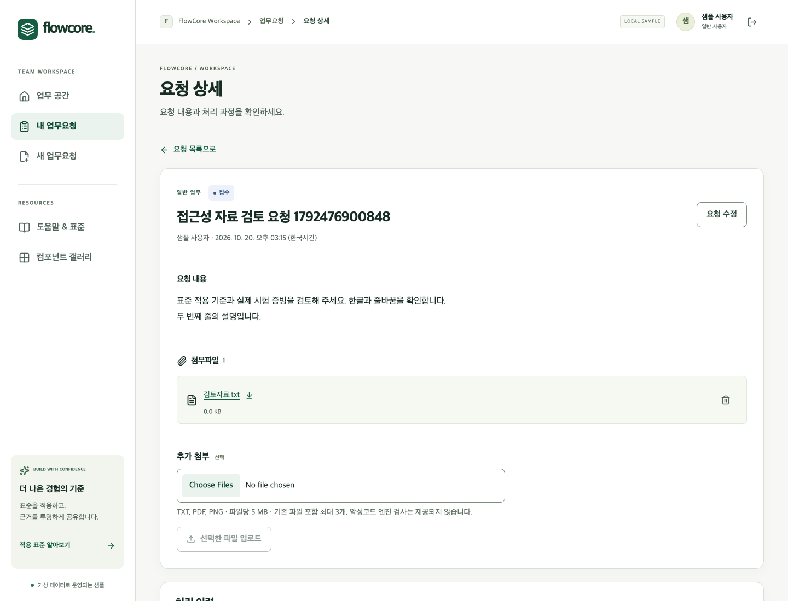
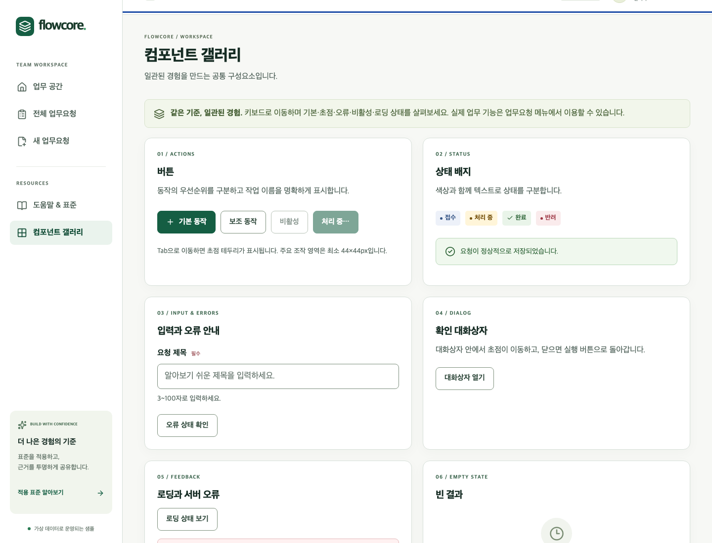

# FlowCore 회사 SW 표준 적용 샘플

회사 SW 표준을 실제 업무요청 프로그램에 적용하고, **표준 ID → 적용 조건 → 구현 코드 → 시험 → 실행 증빙 → Excel·PPTX**로 추적하는 샘플입니다. React + TypeScript strict, ASP.NET Core/.NET 10, EF Core, SQLite를 사용합니다.

일반 사용자는 본인 요청과 첨부자료를 등록·조회·수정하고, 관리자는 전체 요청의 상태와 처리 이력을 관리합니다. 인증·역할·소유권 검사는 서버에서 수행하며, 요청·첨부는 실제 DB와 파일에 저장합니다.

> 회사 표준은 승인 전 초안입니다. 자동시험 통과를 표준 전체 준수, 법적 적합성 또는 웹접근성 인증으로 표현하지 않습니다. README 게시일은 **2026-10-25**, 아래 적용·시험 현황의 기준일은 **2026-10-20**입니다.

[실행과 접속](#실행과-접속) · [표준 및 기준](#표준-및-기준) · [적용 현황](#표준-및-기준-적용-현황) · [화면 예시](#실제-화면-예시) · [주의사항](#적용-시-주의사항) · [수정 요청](#표준-및-기준-수정-요청)

## 실행과 접속

필요 환경은 Git, Node.js 24 이상, Python 3.12 이상, .NET SDK 10.0.402입니다. 실제 확인 환경은 macOS arm64 / Node 26.5.0 / .NET SDK 10.0.402입니다. [global.json](global.json)과 의존성 잠금파일을 보존하세요.

```sh
git clone https://github.com/kyubeomchoi/KSTD_UI.git
cd KSTD_UI
npm run setup
npm run dev
```

| 접속 위치 | 용도 |
| --- | --- |
| <http://localhost:8000> | 샘플 프로그램 |
| <http://localhost:8000/help> | 표준 검색·상세 조회·복사·다운로드 |
| <http://localhost:8000/reports/index.html> | 접근 가능한 HTML 결과보고서 |
| <http://127.0.0.1:8001/api/health> | API·SQLite 상태 확인 |

위 주소는 **실행한 컴퓨터의 로컬 주소**입니다. GitHub 저장소 자체가 웹 프로그램을 호스팅하는 것은 아닙니다. `setup`은 의존성을 복원하고, 최초 서버 실행에서 migration과 개발용 seed를 적용합니다. 종료는 `Ctrl+C`입니다.

### 접속 계정

아래는 공개를 허용한 **현재 작성자 로컬 샘플의 개발용 접속 정보**입니다. 실제 업무·운영 계정에 사용하거나 같은 비밀번호를 재사용하지 마세요.

| 역할 | 아이디 | 현재 로컬 샘플 비밀번호 | 권한 |
| --- | --- | --- | --- |
| 일반 사용자 | `user@sample.test` | `jOZgKfZ8zQ9FJ3U0Tu-l8pgUaA1!` | 본인 요청·첨부 등록/조회/수정/다운로드 |
| 관리자 | `admin@sample.test` | `wjymjDnfeiA9VZvKO0Nj-BSPaA1!` | 전체 요청 조회, 허용된 상태변경, 사유·처리 이력 확인 |
| 타사용자 권한시험 | `other@sample.test` | `jOZgKfZ8zQ9FJ3U0Tu-l8pgUaA1!` | 다른 일반 사용자로 소유권 차단을 시험 |

**새로 clone한 환경에서는 `npm run setup`이 `.env`에 별도의 임의 비밀번호를 생성합니다.** 그 환경의 실제 비밀번호는 `SAMPLE_USER_PASSWORD` / `SAMPLE_ADMIN_PASSWORD`에서 확인하세요. 위 공개 비밀번호가 모든 설치의 공통 기본값은 아닙니다. `.env`가 이미 있으면 setup은 덮어쓰지 않습니다. DB 생성 뒤 `.env`만 수정해도 기존 계정 비밀번호는 바뀌지 않습니다.

DB·첨부·인증키 백업/복원, 포트 충돌, 초기화와 배포는 [RUNBOOK](docs/RUNBOOK.md) 및 [백엔드 운영 안내](docs/BACKEND_OPERATIONS.md)를 참고하세요. 실제 `.env`, DB, 인증키는 저장소에 포함하지 않습니다.

## 표준 및 기준

외부 원문의 요구·권고, 회사가 채택한 MUST/SHOULD, 샘플 설계 선택을 구분합니다. 공식 원문 필수 등급이 확인되지 않은 항목은 미확인으로 유지합니다.

| 기준 | 채택 판본·범위 | 적용 방식과 자료 |
| --- | --- | --- |
| KRDS UI/UX | 제공된 디지털 정부 UI/UX 가이드라인 **2025.08 수정본** 및 변경 대비표 | [원본 PDF](references/), [UI/UX 회사 기준](docs/UI_UX_STANDARD.md). 원문 번호 추출 후보 725개·구조 103개·상호작용 범위 52개를 별도 보존합니다. 이 수치는 공식 기준 총수가 아닙니다. |
| KWCAG 2.2 | KS X OT0003:2022 / 2022-12-28, **33개 검사 항목** | [공식 출처](https://www.rra.go.kr/ko/reference/kcsList_view.do?nb_seq=5247&nb_type=6), [접근성 기준](docs/ACCESSIBILITY_STANDARD.md). `KWA-*` ID로 관리합니다. |
| WCAG 2.2 | W3C Recommendation 2024-12-12 기준, A 31개·AA 24개 | [규범 원문](https://www.w3.org/TR/WCAG22/). `WCA-*` 55개를 KWCAG와 독립적으로 관리합니다. |
| WAI-ARIA / APG | WAI-ARIA 1.2 및 APG 구현 패턴 | [WAI-ARIA](https://www.w3.org/TR/wai-aria-1.2/), [APG](https://www.w3.org/WAI/ARIA/apg/). HTML 의미구조를 우선하고, 모달·탭 등 필요한 위젯에 참고합니다. |
| 개발보안 | 행정안전부 개발보안 가이드 2021 수정배포, OWASP ASVS **5.0.0** 선택 통제와 Cheat Sheets | [보안 회사 기준](docs/SECURITY_STANDARD.md). 서버 검증·인가·CSRF·업로드·오류·감사기록·의존성 등을 구체화합니다. ASVS 전체 L2 준수를 주장하지 않습니다. |
| 개발 프로세스 | NIST SSDF **1.1 Final (2022-02)** 참고 | [공식 원문](https://csrc.nist.gov/pubs/sp/800/218/final). 변경·시험·취약점 후속조치의 회사 기준으로 구체화합니다. |
| 코딩·아키텍처 | TypeScript strict, C# nullable 및 공식 도구 규칙, 회사 코딩 기준 **0.2 승인 전** | [코딩 기준](docs/COMPANY_CODING_STANDARD.md), [아키텍처](docs/ARCHITECTURE.md), [언어별 프로파일](standards/profiles/). 제품 코드인 TS/C# 범위에 적용합니다. |
| 포용적 UX·검증·운영 | 회사 제안 기준 | 장애 유형별 실제 과업, 오류 복구, 시간 연장, 추적성, 백업·변경관리. 당사자 참여 없이 사용자 검증 완료로 기록하지 않습니다. |
| 국방 MDR | 국방 메타데이터 관리시스템 **Meta Data Registry**로 명칭 식별. 공식 목록은 국방데이터 코드설계표준_20260428 | [공식 목록](https://www.data.go.kr/data/15083221/fileData.do?recommendDataYn=Y), [MDR 프로파일](standards/profiles/mdr-pending.json). 원본 코드표·대상 사업 적용범위 미확보로 `MDR-000`은 **확인필요**입니다. MISRA/EU MDR로 치환하지 않습니다. |

정확한 판본·페이지·공식 URL·수집일·접근 상태는 [출처대장](standards/source-register.json)에 있습니다. 법령·공공 지침의 의무 적용 여부는 기관·사업·계약 범위에 따라 별도로 판단해야 합니다.

### 샘플에 적용한 구체적 기준

- **코딩:** TS strict, Promise 처리, C# nullable, Prettier/ESLint/dotnet format, 서버 DTO 허용값·길이 검증, UTC 저장·Asia/Seoul 표시, 취소·타임아웃, 중복 제출과 동시수정 제어.
- **보안:** 프레임워크 비밀번호 해시·인증 쿠키, 역할과 객체 소유권, CSRF, ORM, 업로드 개수·크기·실제 형식 확인, 웹루트 외 랜덤 파일명 저장, 다운로드 인가, 감사기록.
- **UI/UX:** 회사 브랜드, 본문 17px·행간 1.6, 공통 토큰, 검색·필터·정렬·페이지 URL 상태, 단계형 입력·오류요약·뒤로 가기 입력 보존, 개인정보 처리방침 안내.
- **접근성:** 의미구조·레이블·설명·오류 연결, 본문 바로가기, 키보드·초점·모달 복귀, 상태 메시지, 320px 리플로우, 모션 감소, 인증 시간 연장, 비밀번호 붙여넣기 허용.
- **수치의 출처 구분:** WCAG AA 텍스트 4.5:1/큰 글자 3:1, 필요한 비텍스트 3:1과 회사 주요 조작 대상 44×44px·모바일 48×48px 권장 목표를 구분합니다. KRDS 선명한 모드 대비 목표는 별도 조건이며, 샘플의 고대비 테마 구현·검증은 완료되지 않았습니다.

## 표준 및 기준 적용 현황

원본 데이터는 [단일 집계](standards/summary.json), [표준 정의](standards/catalog.json), [적용 기록](standards/application-records.json)입니다. 아래는 **2026-10-20, 시험 기준 commit `88f8c93`**의 결과를 게시한 것이며, README 수정일에 전체 시험을 다시 실행했다는 뜻은 아닙니다.

| 표준군 | 전체 관리행 | 적용 확정 | 조건부 | 해당없음 | 확인필요 | 구현 | 종합 검증완료 |
| --- | ---: | ---: | ---: | ---: | ---: | ---: | ---: |
| 표준 운영 | 8 | 8 | 0 | 0 | 0 | 4 | 0 |
| 코딩 | 18 | 18 | 0 | 0 | 0 | 14 | 0 |
| 보안 | 18 | 17 | 1 | 0 | 0 | 8 | 0 |
| MDR 확인 | 1 | 0 | 0 | 0 | 1 | — | 산정대상 없음 |
| KRDS UI/UX | 128 | 106 | 18 | 4 | 0 | 97 | 0 |
| KWCAG 2.2 | 33 | 29 | 4 | 0 | 0 | 25 | 0 |
| WCAG 2.2 A·AA | 55 | 48 | 7 | 0 | 0 | 40 | 0 |
| 포용적 UX | 12 | 12 | 0 | 0 | 0 | 6 | 0 |
| 검증·운영·보고 | 24 | 24 | 0 | 0 | 0 | 13 | 0 |

- 전체 **297개 관리행**에 시험 절차를 연결했습니다. 적용 확정 **262개 중 구현 207개**이며, 남은 적용 항목 55개는 계획·진행 등 상태를 유지합니다. 조건부 30개, 해당없음 4개, 확인필요 1개는 별도로 관리합니다.
- **종합 검증완료 0개**는 필수 수동 확인·검토자·검토일 등 모든 통과 조건을 갖춘 항목이 아직 없다는 뜻입니다. 실행한 자동시험 결과와 구분합니다. MDR처럼 적용 확정 분모가 0인 경우는 0% 대신 산정대상 없음입니다.
- KWCAG·WCAG·KRDS에는 중복·관련 요구가 있습니다. 관리행을 합산한 값을 고유 기준 개수나 단일 인증 준수율로 해석하지 마세요.
- 시험 정의 **340개** = 규칙별 수동 절차 297개 + 대표 수동 과업 15개 + 자동 그룹 13개 + 화면 캡처 15개입니다. 정의 수를 실제 실행 건수로 표시하지 않습니다.

### 실제 실행한 검사

| 검사 | 실제 결과 | 범위·한계 |
| --- | --- | --- |
| 프런트 format / lint / typecheck / build | 통과 | TS strict와 실제 production build |
| 프런트 단위시험 | 7/7 통과 | API 경계·ID·반환경로·CSV 수식 주입/한글/줄바꿈/대용량 |
| 백엔드 build / format / 단위시험 | 빌드 경고·오류 0, 단위 30/30 통과 | 업무규칙·검증 등 실제 시험 |
| HTTP 통합시험 | 44/44 통과 | 인증·역할/소유권·CSRF·첨부·영속성·중복/동시수정·세션 만료/연장/폐기·백업복원 등 |
| 브라우저 E2E | 6개 그룹 통과 | 업무흐름, Help 복사·다운로드, 키보드, 리플로우, 서버 오류, axe |
| axe 접근성 자동검사 | 21개 화면 상태, 위반 0, 자동판정 불가 20 | 불가 항목은 수동 확인 필요. 실제 화면낭독기 평가와 다릅니다. |
| npm / NuGet 취약점 조회 | 당시 조회 결과 취약점 0 | 검사 시점의 도구·DB 범위입니다. SBOM/의존성 목록을 보존하며 라이선스 법적 검토는 미실행입니다. |
| 로컬 Release 배포본 | 실행·다운로드·CSP·Help 클립보드 확인 통과 | 별도 임시 DB의 로컬 HTTP 환경. 외부 운영 HTTPS 검증과 다릅니다. |
| 증빙 검증 | 통과 | ID·경로·SHA256·commit·시험 시점 소스·근거 없는 PASS 차단 |

[최신 실행 증빙](evidence/index.json) · [원시 결과·실제 캡처](evidence/) · [보고서 검수 기록](evidence/reports/)

### 직접 검사·결과 재생성

```sh
npm run verify
# npm run dev 실행 상태에서 별도 터미널
npm run test:e2e
npm run test:a11y
npm run standards
npm run evidence:check
npm run reports
```

`test:a11y`는 실제 업무 상태를 구성해 axe도 수행하는 통합 검사입니다. `reports`는 기존 증빙으로 보고서를 생성하며 시험을 실행한 것으로 기록하지 않습니다. 보고서 재생성에는 Codex 번들 Artifact Tool 및 presentations runtime이 필요합니다. 앱 실행·기존 보고서 열기에는 필요하지 않습니다. 상세 환경·대체 경로는 [RUNBOOK](docs/RUNBOOK.md)을 참고하세요.

## Help에서 표준 찾아보기와 문서 재사용

1. 로컬 실행 후 [Help](http://localhost:8000/help)에서 ID·요구사항·코드·시험을 검색합니다.
2. 표준군·적용성·검증 결과로 필터링합니다.
3. 항목 상세에서 출처·판본·페이지, 회사 의무 수준, 구현 파일/심볼, 시험 절차, 실제 증빙을 확인합니다. 미구현·조건부 항목에 코드나 실행 증빙이 없으면 해당 상태 그대로 표시합니다.
4. **항목별 복사**로 문서에 붙여 넣거나, 브라우저 클립보드 권한이 막힌 경우 수동 복사창을 이용합니다.
5. 필터 결과를 **JSON·CSV·Markdown**으로 내려받거나 전체 **Excel·PPTX·HTML** 결과물을 이용합니다.

| 결과물 | 저장 위치 |
| --- | --- |
| Excel 적용대장 — 6시트, 필터·고정·상태 검증·계산식 | [Company_SW_Standards_Register.xlsx](reports/Company_SW_Standards_Register.xlsx) |
| PowerPoint 결과보고서 — 편집 가능한 18장 | [Company_SW_Standards_Application_Report.pptx](reports/Company_SW_Standards_Application_Report.pptx) |
| HTML 보고서 — 검색·복사·다운로드 | [index.html](reports/index.html), [report.js](reports/report.js). 같은 폴더로 다운로드하거나 로컬 `/reports/index.html`에서 열기 |
| 데이터·산출물 해시 | [JSON](reports/standards-result.json), [CSV](reports/standards-result.csv), [SHA256 목록](reports/DELIVERABLES.json) |
| 회사 기준 문서 | [코딩](docs/COMPANY_CODING_STANDARD.md), [UI/UX](docs/UI_UX_STANDARD.md), [접근성](docs/ACCESSIBILITY_STANDARD.md), [보안](docs/SECURITY_STANDARD.md) |
| 설계·API·운영 | [아키텍처](docs/ARCHITECTURE.md), [API 계약](docs/API_CONTRACT.md), [ADR](docs/ADR/), [RUNBOOK](docs/RUNBOOK.md) |

GitHub의 HTML 파일 보기는 소스 미리보기입니다. 실제 HTML 화면은 프로그램에서 열거나 HTML과 동반 JS를 함께 내려받아 확인하세요.

## 실제 화면 예시

아래는 **2026-10-20 실제 실행한 샘플의 Playwright Chromium 캡처**입니다. 가상 업무 데이터만 사용하며, 화면 캡처 자체가 표준 전체 통과의 증거는 아닙니다. [캡처와 시험의 연결](evidence/browser/2026-10-20T06-15-00-647Z/E2E-WORKFLOW.json), [증빙 색인](evidence/index.json)에서 환경과 해시를 확인할 수 있습니다.

### 표준 Help: 검색·필터·상세·복사·다운로드



### 홈: 처리 현황과 업무 요약



### 요청 목록: 검색·필터·정렬·페이지 이동



### 단계형 입력과 상세·처리 이력





### 공통 UI 갤러리



[모바일 320px 캡처](evidence/browser/2026-10-20T06-15-00-647Z/screenshots/mobile.png) · [입력 오류](evidence/browser/2026-10-20T06-15-00-647Z/screenshots/form-error.png) · [서버 오류](evidence/browser/2026-10-20T06-15-00-647Z/screenshots/server-error.png) · [모달](evidence/browser/2026-10-20T06-15-00-647Z/screenshots/modal.png)

## 적용 시 주의사항

- **업무별 적용성부터 판단합니다.** 샘플의 적용·조건부·해당없음 결정을 다른 서비스에 그대로 복사하지 않습니다. 계약·기관·콘텐츠·사용자·언어·환경을 확인하고 해당없음 사유와 기능 추가 시 재평가 조건을 기록합니다.
- **기준의 층위를 구분합니다.** 법령·공식 표준, 공식 구현 참고자료, 회사 승인 전 제안, 샘플 설계 선택을 같은 강도의 의무로 취급하지 않습니다. 회사 MUST와 원문 필수 등급도 다릅니다.
- **증빙 없는 PASS를 만들지 않습니다.** 구현 완료와 검증 완료는 별개입니다. 자동검사 일부 확인·이미지·DOM 검사를 실제 AT 음성 평가나 당사자 평가로 승격하지 않습니다. 승인된 회사 편차도 외부 표준 PASS가 아닙니다.
- **접근성 잔여 평가가 있습니다.** NVDA·TalkBack·VoiceOver, 실제 200% 글자/400% 확대, 읽기순서·음성입력·당사자 과업, 원문 등급·그림·비번호 규칙·예외 전수 검토는 완료되지 않았습니다. 고대비 테마를 제공하려면 테마별 목표 대비를 별도 측정해야 합니다.
- **운영 보안 설정은 추가 검증이 필요합니다.** 공개된 개발 비밀번호·개발 seed를 운영에서 사용하지 않습니다. 운영 HTTPS/Secure 쿠키·인증키 보호·악성파일 검사·최소권한·백업복원·모니터링을 검증해야 합니다. 파일 형식 검증을 백신 검사로 표시하지 않습니다.
- **실제 데이터와 개인정보를 넣지 않습니다.** 공개 Issue·스크린샷·첨부에 실제 계정·토큰·개인정보를 올리지 않습니다. README에 공개된 개발 계정 정보와 `.env` 전체 공개는 다릅니다.
- **원장과 출처를 기준으로 변경합니다.** `reference-package/` 원본은 보존하고 수정본은 `standards/`에 기록합니다. 출처의 인쇄 페이지와 PDF 실제 페이지를 구분합니다. 화면의 KRDS 2025.08 기준과 현재 온라인 지침의 변경은 별도 검토합니다.
- **재생성·재시험 범위를 구분합니다.** 소스 수정 뒤 관련 시험을 다시 실행하고 증빙을 갱신합니다. Excel/PPT/README 숫자만 바꾸지 않습니다. 표준 변경은 원장·Help·보고서에 함께 반영합니다. 원격 CI의 실제 실행 상태는 [Actions](https://github.com/kyubeomchoi/KSTD_UI/actions)에서 확인하며, 과거 로컬 결과로 대신하지 않습니다.
- **MDR 적용은 보류 중입니다.** 국방 원본 코드표와 판본, 대상 사업의 등록·준수 요구를 확보한 뒤 별도 프로파일로 검토해야 합니다. 현재 샘플이 국방 MDR 등록·준수를 완료했다고 주장하지 않습니다.

미확정 원문과 운영 전 조치는 [SOURCE_GAPS](docs/SOURCE_GAPS.md), [원문 확인사항](standards/source-gaps.json), [적용대장](standards/application-records.json)에서 확인하세요.

## 표준 및 기준 수정 요청

[표준·기준 수정 요청 작성](https://github.com/kyubeomchoi/KSTD_UI/issues/new?template=standard-change.yml)을 이용해 주세요. 기능 버그·문서 오류도 관련 규칙 ID와 화면을 함께 적으면 영향을 추적하기 쉽습니다.

### 요청에 포함할 내용

| 항목 | 예시·작성 기준 |
| --- | --- |
| 대상 규칙 | `UI-001`, `KWA-001`, `WCA-001`, `COD-001`, `MDR-000` 등. 신규 규칙이면 신규라고 명시 |
| 출처 | 발행기관, 표준명, 판본·개정일, 공식 URL/원문 파일, 절·페이지 |
| 현재 내용과 문제 | 현재 요구사항·구현·판정 중 무엇이 잘못됐는지, 재현 조건 |
| 변경 제안과 근거 | 바꿀 문구, 적용·조건부·해당없음 조건, 원문 요구인지 회사 제안인지 |
| 영향 범위 | 화면·역할·컴포넌트·API·언어 프로파일, 기존 예외와 호환성 |
| 시험과 증빙 | 자동/수동 절차, 예상 결과, 실제 실행한 결과·환경·도구·로그/캡처. 미실행이면 미실행으로 명시 |
| 승인·시행 제안 | 우선순위·희망 시행일·단계 적용·기존 데이터/기능의 이행 필요성 |

코드나 원장을 직접 수정하려면 브랜치를 만들고 Pull Request를 제출하세요. **요청 접수 → 공식 원문·판본 확인 → 적용성·충돌·영향 검토 → 코드/시험/원장 수정 → 관련 시험 실행 → Help·Excel·PPT·HTML 재생성 → 담당자 검토·승인** 순서로 처리합니다. Issue 등록이나 PR 병합만으로 외부 표준 인증이 생기지는 않습니다.

주요 수정 위치는 다음과 같습니다.

| 파일·폴더 | 수정 목적 |
| --- | --- |
| `standards/source-register.json` | 공식 출처·판본·수집일·접근 상태 |
| `standards/catalog.json` | 규칙 정의·회사 수준·적용 조건·필수 검증 방식 |
| `standards/application-records.json` | 적용성·구현·코드/시험/증빙 연결·실제 검토 정보 |
| `standards/tests.json` / `tests/` | 모든 적용 기준의 시험 절차·실행 코드 |
| `standards/deviations.json` | 승인된 편차의 사유·대상·승인자·만료일 |
| `docs/` / `standards/profiles/` | 회사 기준·설계 결정·언어별 프로파일 |
| `evidence/` | 실제 실행 도구가 생성한 로그·캡처·manifest. 기존 실패 이력도 보존 |
| `reports/` / `apps/web/public/` | 같은 원장에서 재생성하는 보고서와 Help 데이터 |

`npm run evidence:check`로 연결·해시·commit·허위 PASS를 확인하고, 변경 이유와 미해결 사항을 [변경 요약](CHANGE_SUMMARY.md)에 남겨 주세요. 검토자·검토일·실제 수동 평가 결과를 임의로 채우거나, 과거 증빙 파일을 고쳐 현재 결과처럼 사용하지 않습니다.
